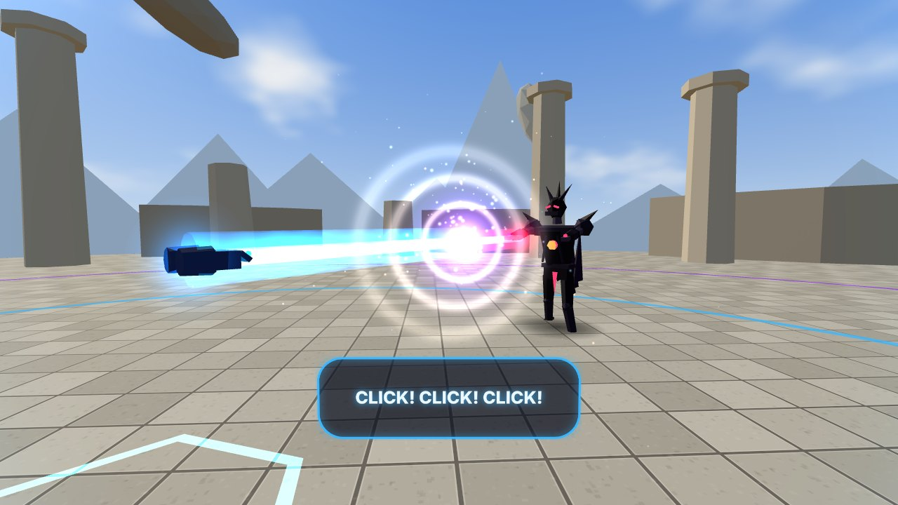
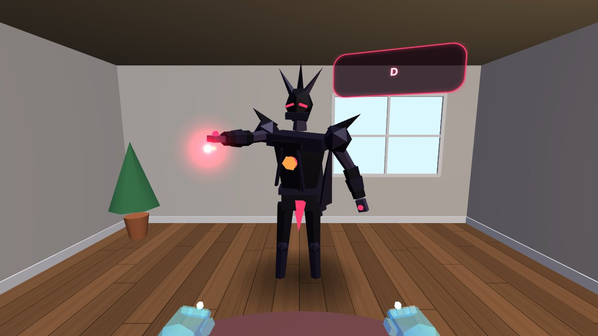
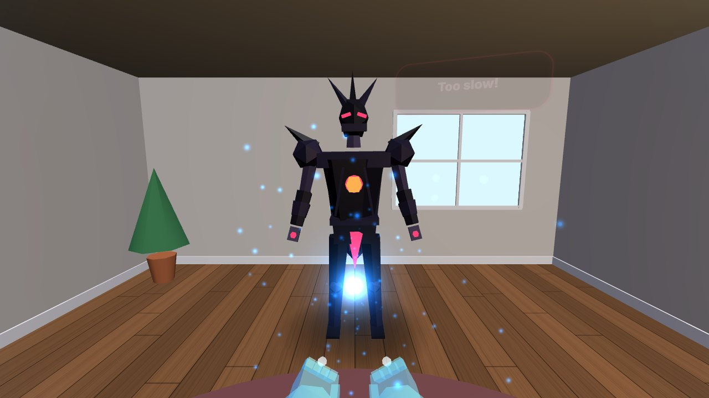
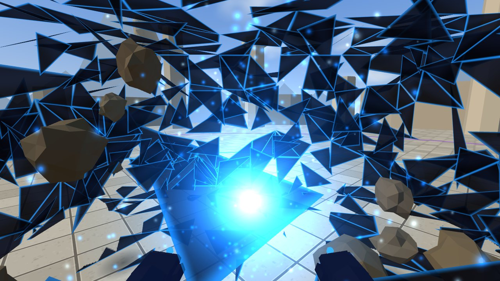
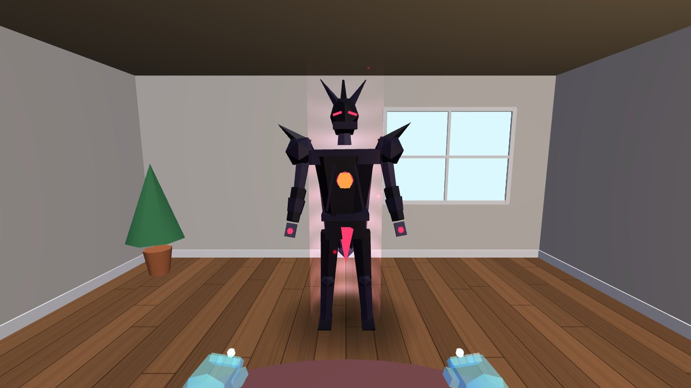
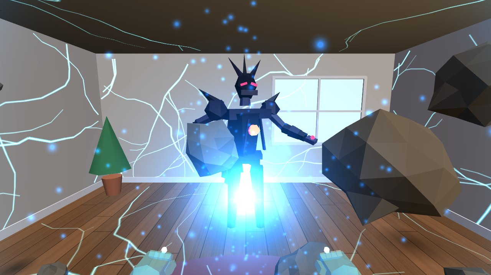
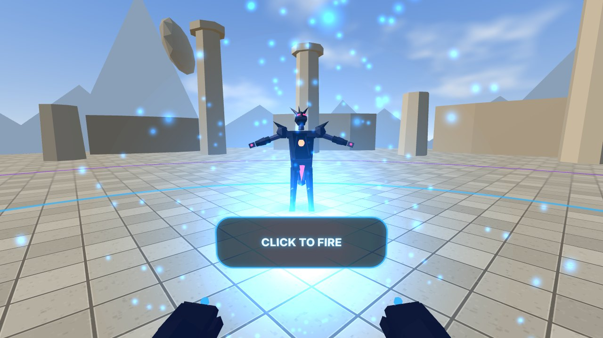
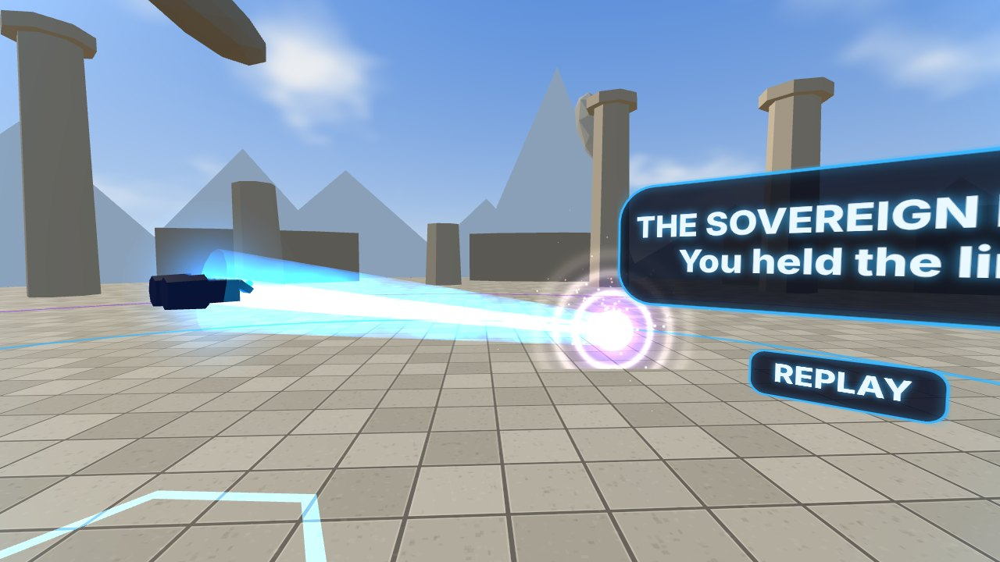
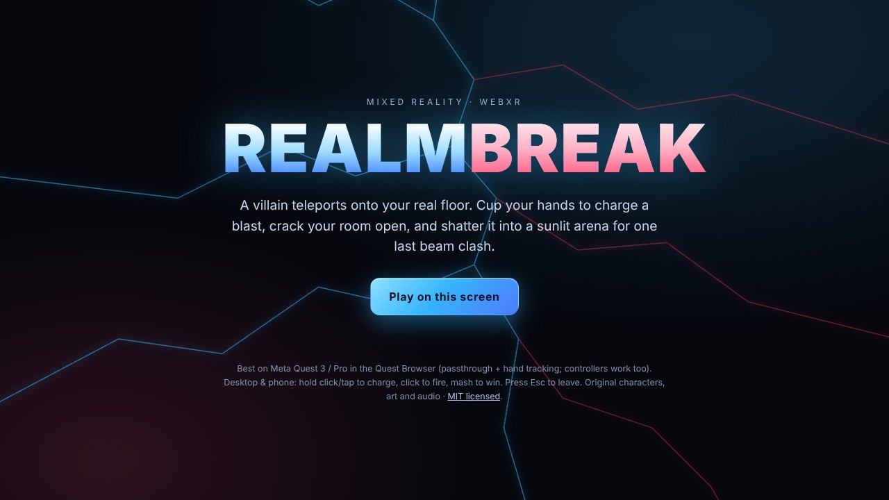

# REALMBREAK

[](https://github.com/mosrvs2025/realmbreak/actions/workflows/ci.yml)
[](LICENSE)

**An original WebXR mixed-reality fight.** A villain teleports onto your real floor, you charge a blast with your bare
hands, your room cracks and shatters into a sunlit arena, and the beams clash. Runs in the Meta Quest Browser
(`immersive-ar` with passthrough + hand tracking, controllers as fallback) and as a regular 3D game on desktop and phone.

Static web app — **Vite + TypeScript + Three.js, no backend.** Every character, model, texture and sound is original
and generated at runtime (procedural low-poly geometry, canvas textures, WebAudio synthesis). No third-party assets.



## The experience

| 1 · A visitor in your room | 2 · Charge | 3 · Realm break | 4 · Beam clash |
| :---: | :---: | :---: | :---: |
|  |  |  |  |

1. **Your room.** Hit-testing finds the real floor (a ray from your head, angled down; ~24 stable samples lock it).
   A life-size (~2 m) villain — *the Null Sovereign* — teleports onto it with a light pillar and a soft contact shadow,
   taunts, and throws glowing orbs that whistle past you (they are aimed to miss — it never hits you).
2. **Charge.** Cup both hands together low at your side (hand-tracking gesture) — or hold a controller trigger. A blue orb
   grows between your hands, a blue aura vignette pulses at the edge of your vision, and procedural rocks tear loose from the
   detected floor and float up.
3. **Realm break.** Glowing blue cracks spread across a room-sized shell fitted to your detected planes (walls, ceiling,
   floor). The passthrough "glass" turns to dark polygon shards that fall away to reveal a full opaque sunlit tiled arena.
   Your gloves swap from translucent *spirit* gloves to armoured *gauntlets*.
4. **Beam clash.** Push your palms forward to fire. The villain fires back; the beams meet in the middle with a push-pull
   struggle — pump your hands forward (or mash the trigger / click) to push the clash point toward the villain. Bloom, sparks and
   shock rings, no camera shake. Win or lose, then **Replay**.

<details>
<summary>More screenshots</summary>

| Teleport-in | Cracks spreading | Arena revealed | Victory + Replay |
| :---: | :---: | :---: | :---: |
|  |  |  |  |

Landing page: 

</details>

## Play

**Meta Quest 3 / Pro (best):** open the deployed site in the Quest Browser → **Enter AR on Quest**. Clear a few metres of
floor. Passthrough, hit-test, hand tracking and plane detection are requested as *optional* features, so the game degrades
gracefully (no planes → default room-sized shell; no hit-test → floor at the reference-space origin; no hands → controllers).

**Desktop / phone:** **Play on this screen**. The same four scenes run in regular 3D against a simulated living room.

| Action | Hand tracking | Controllers | Mouse / touch |
| --- | --- | --- | --- |
| Charge | cup both hands together, low at your side | hold a trigger or grip | hold click / tap (or <kbd>Space</kbd>) |
| Fire the beam | push both palms forward | pull a trigger | click / tap |
| Win the struggle | pump your hands forward | mash a trigger (thrusts count too) | click / tap repeatedly |
| Replay | poke the button, pinch, or look at it ~2 s | point + trigger | click it |
| Leave | exit via the headset menu | exit via the headset menu | <kbd>Esc</kbd> |

If you can't make a gesture, the game never soft-locks: the arena auto-fires after 16 s, and the end screen's Replay can
be triggered by gaze dwell.

## Development

```bash
npm install
npm run dev          # http://localhost:5173 (Quest on the same network: use the printed LAN URL over HTTPS, see below)
npm test             # vitest: gesture, state-machine, clash, crack/shard geometry, pool
npm run typecheck
npm run build        # tsc + vite build
npm run budget       # performance budget gate (also runs in CI)
npm run screenshots  # Playwright captures of the desktop fallback -> docs/screenshots
npm run assets       # regenerate favicon/app icons/og-image from source art
npm run test:xr      # optional local IWER smoke test (not in CI, see limitations)
```

> WebXR requires a secure context. For on-device testing use a tunnel (e.g. `npx localtunnel --port 5173`,
> `ngrok http 5173`) or Chrome's port forwarding — or just deploy a Vercel preview.

Debug/screenshot entry: `/?scene=<intro|charge|crack|shatter|arena|clash|win|lose>&t=<seconds>` fast-forwards the desktop
fallback with scripted input to that scene (`&result=lose`, `&freeze=0` to keep running afterwards).

### Project layout

```
src/
  core/    pure, unit-tested logic (no three.js): gestures, clash model, game state machine, crack/shard
           geometry, object pool, math
  game/    Game orchestrator (maps machine state → visuals), input unification, in-world copy
  gfx/     villain rig, instanced particles/orbs/rocks, room shell (cracks + GPU shards), arena, beams, gloves,
           diegetic text panels, aura vignette, simulated room
  xr/      WebXR session, floor hit-test, plane detection, hand/controller access, capability detection
  audio/   WebAudio synthesis (all SFX are generated at runtime)
tests/     vitest suites
scripts/   screenshots, asset generation, performance-budget check
```

### How the interesting bits work

* **Floor & room.** A hit-test source with an `offsetRay` pointing ~35° below the gaze gives a floor sample every frame;
  the floor locks when 24 consecutive samples agree within 5 cm (median becomes the floor height). Detected planes
  (`plane-detection`) are converted to surfaces; their world-space points are fit to a clamped room box used by the shell.
* **Cracks.** `core/cracks.ts` random-walks branching crack polylines across any surface polygon (the six box faces, plus
  each detected plane), then expands them into flat ribbons. One shader reveals them with a glowing front that spreads from
  your energy orb. One draw call, no per-frame CPU.
* **Shatter.** The same box is tessellated into ~400 jittered triangles. A vertex shader animates their spin/fall from a
  single `uFall` uniform (per-shard delay/axis/speed attributes), so the whole shatter is GPU-only.
* **"Switch to opaque".** The arena is a back-faced sky dome + ground rendered with alpha 1, which fully covers passthrough
  inside the *same* `immersive-ar` session — no session restart, no loading hitch. Replay hides it and passthrough returns.
* **Gestures.** `core/gestures.ts` works on plain `{x,y,z}` joints: cup = palms close + fingers curled (not a fist, not
  flat) + hands low + not reaching forward; push = palm normals toward the villain + hands forward and together + fingers
  open; pump = peak forward speed of the palm midpoint with a refractory/re-arm window. Scores go through a Schmitt-trigger
  latch (`GestureLatch`) so tracking glitches don't flicker the state.
* **Beam clash.** `core/clash.ts` is a tiny deterministic model: pump energy decays exponentially, the villain pushes with a
  steady force plus periodic surges, and the clash point integrates the difference. Tests verify that idle players lose,
  ~5 pumps/s wins across many seeds, and the result is deterministic per seed.
* **Audio.** `audio/sfx.ts` synthesises teleport sweeps, orb zaps, crack clicks, glass-shatter tinkles, a charge hum
  that rises with the charge, a beam roar that follows the clash power, and positional (HRTF) voice blips for taunts.

## Performance budget

Target: **72 fps on Quest 3/Pro.** The design choices that serve it:

* **No post-processing.** Bloom is faked with additive soft sprites; no render targets, no shadow maps (blob contact shadows).
* **Instancing everywhere.** All glows/particles/orbs share billboard `InstancedMesh`es (3 draw calls for the whole
  effect system); rocks and their shadows are two instanced meshes; arena pillars/walls/mountains are instanced.
* **Pooled objects.** Particles (≤720), orbs (12) and everything else are preallocated; nothing is created per frame
  (`core/pool.ts`).
* **Stable shader/light set.** The light count never changes (room ↔ arena only swaps intensities) so no program
  recompiles happen mid-fight. Materials are flat-shaded Lambert/Standard + a handful of tiny custom shaders.
* **Foveation 1** on the XR layer; framebuffer scale left at 1.
* **Adaptive load shedding.** A frame-time governor halves particle density when the 120-frame average misses the
  72 Hz budget (and restores it when there is headroom).
* **Lazy loading.** The landing page is ~3 KB of JS; Three.js + the game load as a separate chunk (prefetched on idle/hover).

CI enforces byte budgets with `npm run budget` (gzip): entry JS ≤ 12 KB, game chunk ≤ 200 KB, CSS ≤ 6 KB, HTML ≤ 8 KB.

## Accessibility & comfort

* `prefers-reduced-motion`: fewer/shorter effects (≈50% particle density, shorter crack/shatter), no pulsing aura, no
  cursor parallax or idle sway, flash intensity capped at ~15–45%.
* No camera shake in any mode. On desktop the clash uses a smooth side-on framing; in VR the world never moves your view.
* The villain's orbs are aimed to miss. Haptics (controllers) are short and low-intensity.
* Three input methods for every action, gaze-dwell fallback for Replay, and an auto-fire assist.
* In-world text only (no head-locked HUD text in VR), high contrast, large type; the landing page is plain semantic HTML.

## Deploying (Vercel)

1. Import the repo in Vercel (framework: Vite — `vercel.json` already sets build/output).
2. In the project settings enable **Web Analytics** and **Speed Insights** (the scripts are already injected via
   `@vercel/analytics` and `@vercel/speed-insights`; they no-op until enabled and in dev).
3. Optional: set `SITE_URL` (otherwise `VERCEL_PROJECT_PRODUCTION_URL` or `https://realmbreak.vercel.app` is used) —
   it is substituted into canonical/Open Graph/Twitter tags, `robots.txt` and `sitemap.xml` at build time.

`vercel.json` sends `Permissions-Policy: xr-spatial-tracking=(self)` (so WebXR works on the origin), basic hardening
headers, `immutable` 1-year caching for hashed `/assets/*`, and long caching for icons and the OG image.

Custom analytics events (`run_start`, `result`, `replay`) carry only a mode/outcome/duration — no personal data.

## Honest limitations

* **Not yet tested on a physical headset.** v1 was verified with unit tests, the desktop fallback in headless Chromium
  (screenshots above) and a manual run in Meta's WebXR emulator (IWER, emulated Quest 3 `immersive-ar` + controllers) that
  played scan → charge → crack → shatter → arena → clash → win without page errors. Real-device testing happens on the live
  site; gesture thresholds (`core/gestures.ts`) and hand/controller feel will likely want tuning there.
* **Known gap — automated XR smoke test.** `npm run test:xr` (IWER-driven, `scripts/xr-smoke.mjs`) is *not* in CI: it is slow
  on software GL, and its final "press Replay with the emulated controller" step does not pass yet. Use it as a local
  helper only.
* Hand-tracking gestures, plane detection and hit-test floor lock cannot be exercised by the emulator and are covered only
  by the pure unit tests.
* Quest's `mesh-detection` isn't used; cracks project onto detected **planes** and a fitted room-sized shell instead.
* Hit-test floor lock needs the headset to have seen the floor; otherwise the game falls back to the reference-space floor
  after a short timeout.

## Originality

Everything in this repository is original: the villain, arena, effects, text and audio are procedurally generated. There
are no characters, names, sounds or designs from any existing franchise.

## License

[MIT](LICENSE) © REALMBREAK contributors
